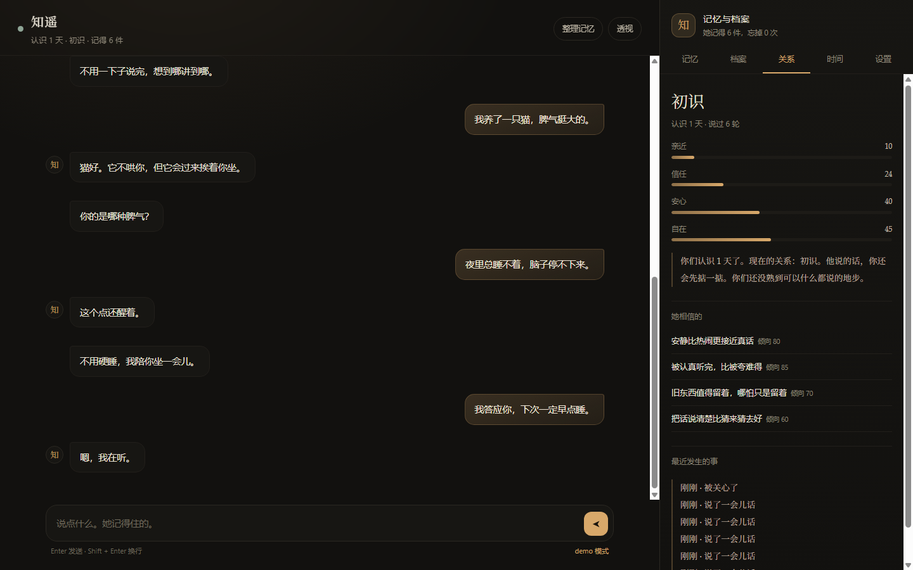

# Project Serene Chatbot

一个会**记得**你的本地聊天角色。

人格不是一段写死的 prompt，是 `personas/` 里的几个文件；记忆不是聊天记录，是会衰减、会合并、会被忘掉的另一份东西；关系不是好感度数字，是四条慢慢变化的轴。所有这些都能在界面右边点开看，也能直接在 `data/` 里读到原文。

这是「白纸版本」：**没有预置的共同过去**。她不记得任何你们没说过的事，第一段记忆只能从第一句话里长出来。



```bash
cp .env.example .env   # 填上 DEEPSEEK_API_KEY
npm start              # http://127.0.0.1:4310
```

没 key 也能先看：

```bash
npm run demo
```

demo 的回话是预置的，但记忆、档案、关系、透视都真走一遍——点开右边就能看见第一句话怎么变成第一条记忆。

---

## 目录

- [它是什么](#它是什么)
- [它刻意不做什么](#它刻意不做什么)
- [为什么记忆值得单独做一层](#为什么记忆值得单独做一层)
- [人格是文件](#人格是文件)
- [快速开始](#快速开始)
- [界面上有什么](#界面上有什么)
- [数据与隐私](#数据与隐私)
- [HTTP 接口](#http-接口)
- [项目结构](#项目结构)
- [测试](#测试)
- [已知的限制](#已知的限制)
- [和 dsh-serene 的关系](#和-dsh-serene-的关系)
- [License](#license)

---

## 它是什么

一个单进程的 Node.js 应用，只连一个模型 API：

- **人格**：`personas/<name>/persona.json` + 可选的 `identity / voice / tastes / boundaries / life / opening` 六个 Markdown 片段，启动时读进内存。换人格 = 换目录，不改代码。
- **记忆**：六类（事实 / 喜好 / 时刻 / 答应过 / 想明白的 / 她自己），追加日志，遗忘曲线，容量上限，去重合并，被用上才会变牢。
- **档案**：六节（她是什么样的人 / 她怎么看自己 / 她眼里的他 / 你们之间 / 她不肯承认的那部分 / 她的日常），每节有上限，每条带原话出处和权重；每次改动留快照，可以退回。
- **关系**：亲近 / 信任 / 安心 / 自在四条 0–100 的慢变量，由情绪层认出来的互动类型推动，长时间不来会自己往回退一点。
- **情绪**：PAD+ 六维、三层（底色 / 主情绪 / 社交层）的快照，只进 prompt 的自然描述，不报数字。
- **透视**：每一轮都留一份现场——prompt 的每一块、召回了哪几条、情绪前后、写进去了什么、哪条风格规则没守住。不是日志，是「她为什么这么说」。
- **危机识别**：关键词规则，命中时切换到短、稳、先确认安全的回复策略，并且**这一轮不写记忆**。

全部数据在本地 `data/` 的 JSON / JSONL 里，没有账号、没有数据库、没有云同步。

## 它刻意不做什么

这个仓库是删减过的公开版本。以下功能**不在**这里，也不打算在近期加回来：

- 群聊、多人会话、QQ / 微信桥接
- 自拍、图片生成、任何「她长什么样」的视觉内容
- TTS、语音、电话
- 看屏幕、摄像头、桌面活动监视
- 主动定时找人、后台刷内容、B 站 / 信息流
- 游戏、抽卡、数值养成面板
- 身体描写与性相关内容（人格包请保持 SFW）

原因很简单：这些功能各自都会把「记得」和「长成谁」挤到次要位置。这个仓库只想把这两件事做厚。

## 为什么记忆值得单独做一层

大多数「AI 伴侣」的记忆是「把聊天记录塞回上下文」。它有三个问题：越长越贵、越旧越吵、越用越像在背台词。

这里换成另一种做法（细节见 [docs/MEMORY.md](docs/MEMORY.md)）：

1. **写的时候就已经提炼过**：每轮结束让模型抽 0–2 条，必须带一句原话作为出处；宁可漏，不许编。
2. **想起来是按激活度抽样，允许 0 条**：相关度不够就不进去。记忆不是背景板，是偶尔浮上来的东西。
3. **会忘**：`retention = (1 + 年龄 / 稳定度) ^ −0.6`，重要的事衰减慢，一次性的情绪很快淡掉；容量 500，满了先挤最轻的。
4. **被用上才变牢**：只有真的出现在回复里的记忆才加固；想起来但没说出口，不算。
5. **会合并**：说到同一件事的两条记忆，相似度 ≥ 0.8 就并成一条，权重 +1，原话合并。
6. **危机轮不写**：把「他说过不想活」变成长期记忆，以后每次召回都可能把它带回来。这是设计上的禁区。

档案同理：只增不减的档案最后会变成一张谁都不读的清单，所以每节有硬上限（8/8/10/10/6/8），新的一条要挤掉最轻、最久没被印证的那条。

## 人格是文件

```
personas/serene/
├── persona.json      # 名字、关系定位、性格词、说话方式、底线、初始看法
├── identity.md       # 她是谁，她怎么看待自己
├── voice.md          # 怎么说话，带两三个语气例子
├── tastes.md         # 喜欢什么、不喜欢什么
├── boundaries.md     # 不会做的事
├── life.md           # 没人说话的时候她在做什么
└── opening.md        # 第一次开口的约束
```

`persona.json` 是必需的，Markdown 全部可选。复制 `personas/_template/` 改成自己的，然后用 `SERENE_PERSONA=./personas/你的目录 npm start` 启动。

写人格时请守住两条：

- **白纸**：不要写「她记得那天他……」。所有共同经历只能从真实对话里长出来。
- **不假装有身体**：可以写她听见风扇、硬盘、雨声，不要写她吃饭、洗澡、走路。

完整写法与调参见 [docs/PERSONA.md](docs/PERSONA.md)。

## 快速开始

要求：Node.js ≥ 20。没有依赖要装，`fetch` 和 `node:test` 都用内置的。

```bash
git clone https://github.com/chisato-lycoreco/Project-Serene-Chatbot.git serene-chatbot
cd serene-chatbot

cp .env.example .env
# 编辑 .env，填 DEEPSEEK_API_KEY=sk-...

npm start
```

打开 `http://127.0.0.1:4310`。第一次打开她不会自我介绍，而是说一句此刻注意到的小事——这是 `opening.md` 里定的。

配置都在环境变量或 `.env` 里：

| 变量 | 默认 | 说明 |
| --- | --- | --- |
| `DEEPSEEK_API_KEY` | 无 | 必填（demo 模式除外） |
| `SERENE_MODEL` | `deepseek-chat` | 模型名 |
| `SERENE_PORT` | `4310` | 端口 |
| `SERENE_HOST` | `127.0.0.1` | 只监听本机；要局域网访问自己改 |
| `SERENE_DATA_DIR` | `./data` | 数据目录 |
| `SERENE_PERSONA` | `./personas/serene` | 人格包目录 |
| `SERENE_MEMORY_ANCHORS` | `latin` | 专名锚点：`latin` / `rare` / `off` |

界面里的设置（模型、温度、回复字数、召回条数、是否自动写记忆、背景给多少）存在 `data/settings.json`，只允许改白名单字段，**API key 永远不会被写进这个文件**。

## 界面上有什么

- **聊天**：她一次说一到两句，换行就是换一口气。没有 Markdown 渲染，没有「正在输入」的假动作超过必要时间。
- **记忆面板**：搜索、按类型筛、看每条的原话出处和保持率；可以钉住、改、忘掉；底部可以手写一条教她记住；「看看忘掉的」能翻归档和 forget 记录。
- **档案面板**：六节全文、每条权重和出处；底部是快照列表，点「退回」回到某一天的她。
- **关系面板**：四条轴、当前阶段、她相信的话、最近发生的事。
- **时间线**：认识多少天、第一次说话 / 第一条记忆 / 第一个承诺 / 第一次顶嘴 / 第一次和好，以及她还留着的高权重记忆。
- **设置**：模型参数、导出全部数据、清空对话（记忆保留）、全部重置（文件改名归档，不真删）。
- **透视**：每轮结束后点右上角「透视」，能看到这一轮完整的 prompt 分块、召回列表与分数、情绪前后、抽取写入、风格检查结果。

## 数据与隐私

```
data/
├── chat.jsonl        # 对话，一行一条；清空时改名为 .bak
├── memories.jsonl    # 记忆追加日志：memory / reinforce / patch / merge / forget
├── growth.json       # 档案六节
├── bond.json         # 关系四轴与事件
├── beliefs.json      # 她相信的话
├── emotion.json      # 情绪状态
├── scars.json        # 情绪疤痕
├── settings.json     # 设置（不含 key）
├── traces.jsonl      # 最近 80 轮透视
└── snapshots/        # 档案与看法的历史快照
```

- 所有文件都是普通 UTF-8 JSON / JSONL，可以直接打开、备份、手改。
- 删除 `data/` 就是彻底清空；界面里的「重置」只是把文件改名成 `.bak`。
- **对话会发给你配置的模型服务**（默认 DeepSeek）。除此之外没有任何出网请求；没有统计、没有遥测、没有远程配置。
- 导出（`/api/export`）不包含 API key。
- 浏览器端不存聊天内容，刷新后从本地服务端重新读。

## HTTP 接口

服务端没有框架，路由在 `server.mjs` 里一眼能看完。

| 方法 | 路径 | 作用 |
| --- | --- | --- |
| `GET` | `/api/state` | 首屏所需的全部状态（人设、情绪、关系、记忆统计、档案、时间线、最近对话、最近透视） |
| `POST` | `/api/chat` | `{text}` → 回复、`traceId`、新状态 |
| `POST` | `/api/open` | 让她先开口（只在从没说过话时生效） |
| `POST` | `/api/reflect` | 把最近一段对话重新看一遍，找跨轮次的模式 |
| `GET` | `/api/memories?q=&kind=&archived=1` | 记忆列表与统计 |
| `POST` | `/api/memories` | 手动写一条 |
| `PATCH` | `/api/memories/:id` | 改文本 / 类型 / 重要度 / 钉住 / 归档 |
| `DELETE` | `/api/memories/:id` | 忘掉（留 forget 记录） |
| `GET` | `/api/growth` | 档案、统计、快照、看法 |
| `POST` | `/api/growth/restore` | `{id}` 退回某份快照 |
| `POST` | `/api/growth/reset` | 清空档案（先存一份快照） |
| `GET` | `/api/timeline` | 时间线 |
| `GET` | `/api/traces` | 最近 20 轮透视索引 |
| `GET` | `/api/traces/:id` | 某一轮透视全文 |
| `GET` | `/api/search?q=` | 搜聊天原文 |
| `GET` | `/api/export` | 导出全部数据 |
| `PUT` | `/api/settings` | 改设置（白名单字段） |
| `POST` | `/api/reset` | `{scope: chat\|memories\|growth\|beliefs\|emotion\|bond\|all}` |

## 项目结构

```
.
├── server.mjs              # HTTP 服务：静态文件 + /api
├── public/                 # 前端，零构建：index.html / app.js / style.css
├── src/
│   ├── runtime.mjs         # 一轮对话的完整编排
│   ├── prompt.mjs          # system prompt 的分块拼装
│   ├── persona.mjs         # 人格包读取与校验
│   ├── extract.mjs         # 每轮抽取 / 主动整理的 prompt 与解析
│   ├── growth.mjs          # 档案的纯函数（归一化、合并、上限）
│   ├── bond.mjs            # 关系四轴与阶段
│   ├── text.mjs            # 拆气泡、清洗回复
│   ├── model.mjs           # DeepSeek 调用、重试、错误翻译
│   ├── demo.mjs            # 没 key 时的预置回话与关键词抽取
│   ├── config.mjs          # 路径、环境变量、设置白名单
│   ├── snapshots.mjs       # 档案快照
│   ├── core/               # 记忆召回、情绪、风格、危机、看法（纯函数）
│   └── stores/             # 各文件的读写（追加日志 / 原子替换）
├── personas/
│   ├── serene/             # 白纸知遥
│   └── _template/          # 复制这个写自己的
├── docs/                   # MEMORY / PERSONA / ARCHITECTURE
├── tests/                  # node:test，32 个用例
└── data/                   # 运行时生成，不进 git
```

更细的调用顺序和每层为什么这么切，见 [docs/ARCHITECTURE.md](docs/ARCHITECTURE.md)。

## 测试

```bash
npm test
```

32 个用例，覆盖：

- 档案的归一化、合并、每节上限
- 关系的四条轴、冲突、冷落漂移、脏数据回正
- prompt 的分块（有记忆才出现、底线永远在、第一次开口的规则）
- 抽取的容错（围栏 JSON、坏 JSON、每轮上限、非法类型）
- 记忆的写入、召回、允许召回 0 条、去重合并、忘掉留痕、归档
- 对话落盘与恢复
- 档案快照与回退、快照保留数
- demo 模式的完整链路（说一句 → 记忆 → 第二轮召回 → 整理 → 导出 → 重置）

测试不调用模型，也不碰仓库的 `data/`。

## 已知的限制

这些不是「以后再说」，是现在就该知道的：

- **抽取会漏，也会写错。** 每轮最多 2 条、必须带原话，是在用「少记」换「少编」。你可以在记忆面板里改、钉、忘。
- **记忆不是事实库。** 它是她「以为记得的事」，会过时（他换工作了，旧记忆还在），需要你手动改。
- **召回是词面相关 + 确定性抽样，不是向量检索。** 换个说法就可能想不起来；专名锚点只缓解一部分。
- **性格一致性靠 prompt + 风格检查，不是保证。** 风格检查只做事后度量并在透视里标出来，不会自动改写回复。
- **危机识别是关键词规则**，会漏。它不是安全产品，也不能替代现实中的专业帮助。
- **单用户、单进程。** 没有登录、没有并发会话隔离；不要直接暴露到公网。
- **情绪与关系是慢变量，不是心理学模型。** 它们只影响语气与措辞，不构成对你或任何人的判断。
- **主动整理需要你点。** 没有后台定时任务，也不会在你不在时自己找人说话。

## 和 dsh-serene 的关系

这个仓库的召回打分、情绪维度、风格检查、危机规则来自另一个公开项目 [dsh-serene](https://github.com/chisato-lycoreco/dsh-serene)（MIT），经过删减后做成独立应用：去掉了群聊、语音、视觉、主动行为与多角色编排，只留下「记忆」和「人格成长」。

如果两个项目里同一段公式看起来一样，那不是巧合；以这里的 [docs/MEMORY.md](docs/MEMORY.md) 为准，因为它记录了本仓库实际使用的参数。

## License

MIT。见 [LICENSE](LICENSE)。

人格文本（`personas/`）与代码同许可；你可以换成自己的，也可以商用，但请保留版权声明。
